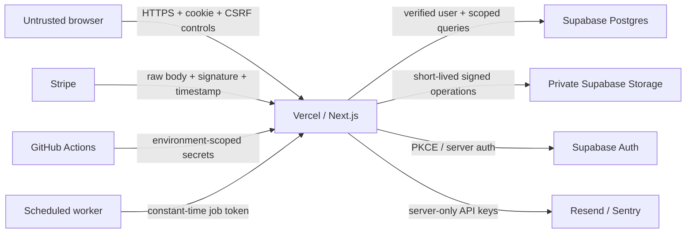

# TaskFlow threat model

Owner: Security Lead. Reviewers: Engineering Lead, Product Owner, Operations. Review at least quarterly and before adding a new external integration, privileged role, sensitive field, or mobile client.

## Scope and assets

The model covers the Next.js web application, Supabase Auth/Postgres/Storage, Stripe, Resend, Sentry, scheduled workers, CI/CD, and operator access. The primary assets are private workspace/project/task/comment data, attachment contents, authentication and invitation tokens, session/refresh credentials, member roles, Stripe identifiers and entitlement state, secrets, recovery data, and activity/audit records.

## Actors

- User: Owner, Admin, Member, or Guest with an authenticated browser session.
- Platform admin: provider or database administrator with infrastructure access.
- Support: staff handling account and incident requests; no standing tenant-data access.
- Worker: scheduled deletion, reminder, email, and recovery jobs using narrowly scoped server credentials.
- Provider: Supabase, Stripe, Resend, Sentry, Vercel, and GitHub.
- Attacker: anonymous remote attacker, malicious tenant member, compromised account, compromised dependency/provider, or insider.

## Trust boundaries

1. Untrusted browser/device -> Vercel edge and Next.js route handlers.
2. Next.js server -> Supabase Auth, Postgres, and private Storage.
3. Stripe/other providers -> signed webhook endpoints.
4. GitHub Actions/Vercel deployment -> staging or production secrets and infrastructure.
5. Scheduled worker -> internal job endpoint and tenant data.
6. Operations/support -> provider dashboards and incident tooling.

Browser state, route IDs, role/tenant/price fields, filenames, MIME metadata, and mobile integrity signals are untrusted. Authorization is enforced again at the route, data-access, and database layers.

## Principal data flows

## Threat register

| ID / threat | Preconditions | Impact | Preventive controls | Detection | Recovery | Accountable owner |
|---|---|---|---|---|---|---|
| T01 Cross-tenant object access | Attacker has a valid account and another tenant ID | Confidentiality/integrity breach | Workspace + membership + role + object relationship in every query; RLS; private-project grants; DTO allowlists | 403/404 anomaly logs; tenant-matrix and staging E2E | Revoke sessions, suspend account, scope audit, notify affected tenants, restore changed rows | Backend Lead |
| T02 Privilege or mass-assignment escalation | User can submit hidden role, owner, tenant, plan, or price fields | Admin takeover or billing fraud | Strict input schemas; server-derived user/tenant/role/price; step-up authentication; database constraints | Audit privileged changes; alert impossible role transitions | Revert role/entitlement from audit/provider truth; revoke all sessions | Backend Lead |
| T03 Credential stuffing/account enumeration | Reused credentials and automated login attempts | Account takeover | Provider password policy; IP + account + device/action rate limits; generic responses; MFA for privileged roles; risk CAPTCHA | Login-failure and rate-limit events; burst alert | Revoke sessions, force reset, require MFA, notify user | Identity Owner |
| T04 Session/refresh-token theft | XSS, malware, log leakage, or stolen device | Persistent account access | HttpOnly Secure SameSite cookies; strict CSP; short JWT; refresh rotation/reuse detection; step-up; revoke local/others/global | Refresh-reuse/provider alerts; new-session and sensitive-action audit | Revoke affected/all sessions, rotate credentials, investigate XSS/logs | Identity Owner |
| T05 Password-reset/invitation abuse | Token or mailbox compromised | Account/workspace takeover | Random single-use expiring provider/reset tokens; hashed invitation tokens; safe redirects; generic responses | Repeated invalid/expired token events | Revoke tokens/sessions, resend secure link, restore membership | Identity Owner |
| T06 CSRF/cross-origin mutation | Authenticated browser visits attacker-controlled origin | Unauthorized mutation | Exact Origin/Fetch-Metadata validation; reject originless cookie mutations; SameSite cookie; signature-route exemption only | `cross_site_mutation_blocked` logs and alert | Revoke session if action succeeded, revert through audit | Web Platform Lead |
| T07 XSS/content injection | Attacker stores or reflects crafted text/HTML/filename | Token/data theft or actions as victim | React contextual encoding; HTML allowlist if introduced; strict nonce CSP; no token in URL; output DTOs | CSP reports/Sentry and payload regression tests | Remove payload, revoke sessions, patch sink, notify affected users | Web Platform Lead |
| T08 Malicious attachment/polyglot | Authorized user uploads disguised content | Malware delivery, stored XSS, resource abuse | Server-generated name; extension/MIME/magic-byte match; size/quota; quarantine; malware scanner; private storage; signed download | Scan verdict logs, mismatch counters, upload-burst alert | Delete/quarantine object, suspend uploader, rescan related files | Storage Owner |
| T09 Forged/replayed/out-of-order webhook | Attacker reaches webhook or replays a valid event | False subscription/entitlement | Raw-body signature, five-minute timestamp tolerance, unique event ID, provider timestamp ordering, server-derived price | Invalid signature, duplicate and stale-event logs | Replay provider events, reconcile subscription from Stripe, revoke false entitlement | Billing Owner |
| T10 Secret or PII leakage | Secret committed, logged, exposed in artifact/chat | Provider or tenant compromise | Environment secret stores, least privilege, CI secret scan, recursive log redaction, no recovery artifacts | Git/provider scanning and secret-use anomaly alerts | Treat as exposed: rotate, revoke, audit usage and affected data | Operations Lead |
| T11 Audit tampering/repudiation | Compromised app/service credential or insider | Loss of forensic evidence | Append-only application API, DB update/delete guard, restricted grants, structured correlation IDs, external log export | Integrity verification and missing-sequence alerts | Preserve external logs, rotate privileged credentials, reconstruct from provider records | Security Lead |
| T12 SSRF/egress abuse | A feature accepts a remote URL | Metadata/private-network access | HTTPS-only URL parser, DNS resolution, private/metadata IP block, explicit host allowlist, timeout and response-size limit | Blocked-target logs and egress alerts | Rotate exposed instance/provider credentials, block destination, investigate access logs | Web Platform Lead |
| T13 Worker/job spoofing | Internal endpoint is internet reachable | Bulk deletion/email/data mutation | Long secret in environment, constant-time digest comparison, idempotent bounded jobs, least privilege | Failed job-token and abnormal batch-size alerts | Rotate token, stop scheduler, restore affected tenant data | Operations Lead |
| T14 Backup loss/corruption | Provider outage, operator error, or destructive deploy | Availability and permanent data loss | Managed backups/PITR before production; checksummed bundle; isolated restore rehearsal | Scheduled rehearsal failure and checksum alerts | Restore into isolated project, validate, approve cutover per runbook | Operations Lead |
| T15 Mobile client compromise | APK/IPA inspection, rooted device, hook/repackaging | Token theft and business-rule bypass | No embedded secrets; Keychain/Keystore; server authorization/price checks; optional attestation as risk signal | Device/account anomalies and attestation changes | Revoke sessions, force upgrade, rotate public-client configuration if needed | Mobile Lead |

## Abuse and incident requirements

- Every detection event carries a request/correlation ID, environment, route/action, and non-sensitive actor or workspace identifier.
- Security alerts must route to the accountable owner and Operations; high-severity acknowledgement target is 15 minutes.
- Recovery follows `docs/operations/disaster-recovery.md`; secrets observed in Git, logs, tickets, or chat are rotated rather than merely deleted.
- Root/jailbreak detection, obfuscation, UUID unpredictability, CORS, and client-side role checks are signals or friction only. None replace server-side object authorization.
